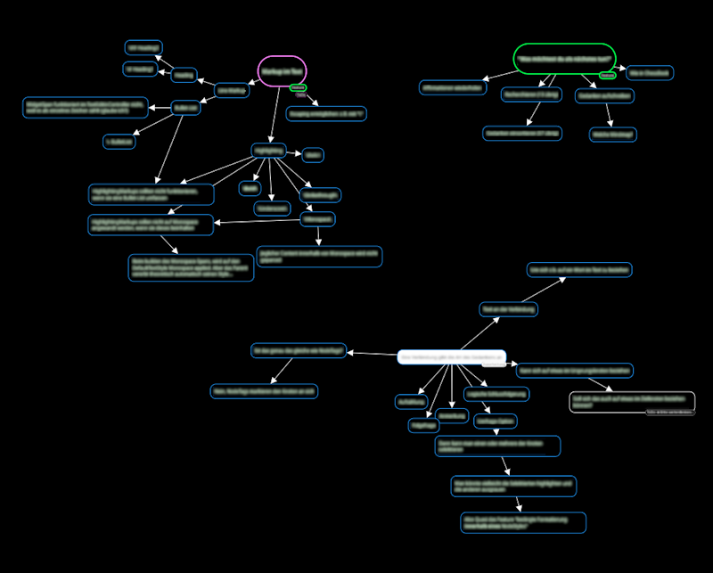

<p align="center">
  <a href="https://pub.dev/packages/interactive_graph_view">
    
  </a>
</p>

A performant rendering library for displaying and manipulating custom-defined graph structures through a simple and intuitive API, that gives you maximum control over the graph's look and feel.  
It was designed from the ground up to be fully integrated with flutter's architecture.



## Features

- Custom graph viewport, node and edge widgets
- Children arre built lazily (only when necessary)
- Built-in panning, scaling and scrolling of the viewport
- Built-in dragging of one or multiple nodes
- Custom styling
- Flutter `Theme` integration
- Intuitive API
- Graph-structure-agnnostic: You can define your own types and classes for the graph-structure - the package only knows of the IDs 

## Getting started

Add this package to your `pubspec.yaml` file:

```bash
$ flutter pub add interactive_graph_view
```

## Usage

### 1. Import the package:

```dart
import "package:interactive_graph_view/interactive_graph_view.dart";
```

### 2. Create model classes for your nodes and edges:

```dart
class ExampleNode extends StaticGraphViewportNodeModel {
  const ExampleNode({required this.id, required this.position});

  final String id;

  @override
  final Offset position;

  @override
  bool shouldRebuild(ExampleNode previous) {
    return previous.position != position;
  }
}

class ExampleEdge extends StaticGraphViewportEdgeModel<String> {
  const ExampleEdge({required this.id, required this.startNodeId, required this.endNodeId});

  final String id;

  @override
  final String startNodeId;

  @override
  final String endNodeId;

  @override
  bool shouldRebuild(ExampleEdge previous) {
    return previous.startNodeId != startNodeId
        || previous.endNodeId != endNodeId;
  }
}
```

### 3. Create and save `GraphViewportTransform` and a `GraphViewportController` in your `StatefulWidget` and give the controller your graph data:

```dart
class YourWidget extends StatefulWidget with TickerProviderStateMixin {
  const YourWidget({super.key});

  @override
  State<YourWidget> createState() => _YourWidgetState();
}

class _YourWidgetState extends State<YourWidget> {
  final Map<String, ExampleNode> _nodes = {
    "node-1": ExampleNode(position: (0, -75), text: "Hello"),
    "node-2": ExampleNode(position: (0, 75), text: "World"),
  };
  final Map<String, ExampleEdge> _edges = {
    "edge-1": ExampleEdge(startNodeId: "node-1", endNodeId: "node-2", text: "wonderful"),
  }

  late final GraphViewportController<String, String, ExampleNode, ExampleEdge> _graphViewportController;
  late final GraphViewportTransform _graphViewportTransform;

  @override
  void initState() {
    super.initState();

    _graphViewportController = GraphViewportController(initialNodes: _nodes, initialEdges: _edges);
    _graphViewportTransform = GraphViewportTransform(vsync: this);
  }

  // ...
}
```

### 4. Build the `GraphViewport` in your widget's build() method

```dart
@override
Widget build(BuildContext context) {
  return Scaffold(
    appBar: AppBar(
      title: Text("Graph View Demo"),
    ),
    body: GraphViewport<String, String, ExampleNode, ExampleEdge>(
      controller: _graphViewportController,
      transform: _graphViewportTransform,
      nodeBuilder: (context, nodeId, node) {
        return NodeWidget.basic(
          text: node.text,
          isDragEnabled: true,
        );
      },
      edgeBuilder: (context, edgeId, edge) {
        return EdgeWidget(
          text: edge.text,
        );
      },
    ),
  );
}
```

## Contributing

You are welcome to contribute to this package!

If you've got a feature request or run into a bug, please do not hesitate to open an issue in the GitHub repository. 😊

## License

This package is under the [MPL 2.0 License](https://www.mozilla.org/en-US/MPL/2.0/).